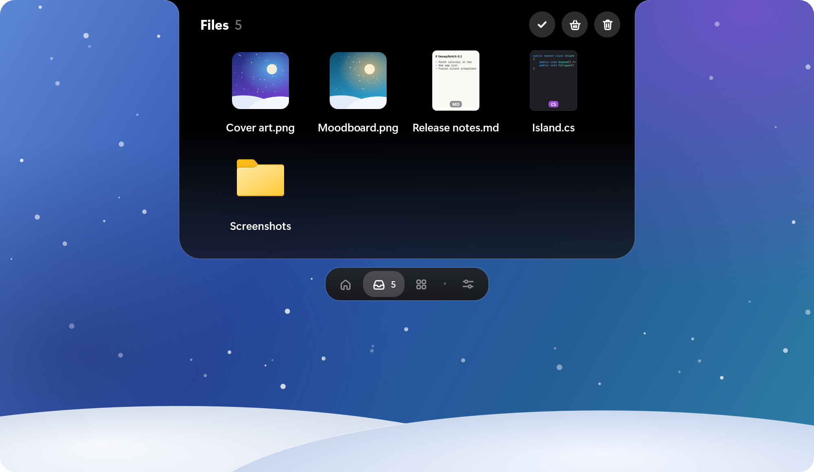

# SnowyNotch

A Dynamic Island–style notch for Windows. It sits at the top edge of the screen, expands on hover, and keeps music, quick tools and dropped files one move away.

<p align="center">
  
</p>

<table>
  <tr>
    <td width="50%"><p align="center"><b>Now Playing</b> on hover</p></td>
    <td width="50%"><p align="center"><b>Lyrics</b> that follow the song</p></td>
  </tr>
  <tr>
    <td><p align="center"><b>Widgets</b> one click away</p></td>
    <td><p align="center"><b>Clock</b> with a month calendar</p></td>
  </tr>
  <tr>
    <td><p align="center"><b>File tray</b>: drop files, drag them back out</p></td>
    <td><p align="center"><b>Timer</b> and Pomodoro</p></td>
  </tr>
  <tr>
    <td colspan="2"><p align="center"><b>Settings</b>: shape, glass finish, accent color and more</p></td>
  </tr>
</table>

## Features

- **Now Playing**: artwork, progress, playback controls and lyrics for whatever is playing in Windows.
- **Widgets**: sound (per-app volume), clock with month calendar, timer, stopwatch, system monitor, Markdown notes, AI agent usage.
- **Home row**: pin up to 4 widgets side by side and rearrange them right inside the island.
- **File tray**: drop files onto the island to keep them handy, then drag them back out.
- **Live activities**: running timers and similar show up as bubbles next to the collapsed island.
- **Interface languages**: English, Русский, Українська, Deutsch, Français, Español, Italiano, Polski, Português, Svenska.

## Download

Grab the latest build from [Releases](../../releases):

| File | Size | Notes |
|---|---|---|
| `SnowyNotch-x.y.z-win-x64.exe` | large | Works out of the box, nothing to install |
| `SnowyNotch-x.y.z-win-x64-lite.exe` | small | Needs [.NET 8 Desktop Runtime](https://dotnet.microsoft.com/download/dotnet/8.0) |

Requires Windows 10 version 2004 (build 19041) or newer, x64.

The exe is not code-signed, so Windows SmartScreen may warn on first launch: click **More info → Run anyway**.

## Hotkeys

| Keys | Action |
|---|---|
| `Win + /` | Open / close settings |
| `Win + Alt + V` | Per-app volume |

Settings, notes and tray files are stored in `%AppData%\SnowyNotch`.

## Building from source

Needs the [.NET 8 SDK](https://dotnet.microsoft.com/download/dotnet/8.0).

```powershell
dotnet run                     # build and launch (Debug)
.\build-release.ps1            # release exe files -> ..\SnowyNotch-release\Release
dotnet run -- --shots=C:\shots # regenerate README screenshots (Debug only, demo data)
```

Screenshots use a made-up track, artwork and lyrics.

## License

[MIT](LICENSE)
