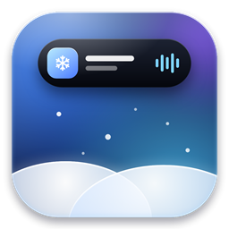
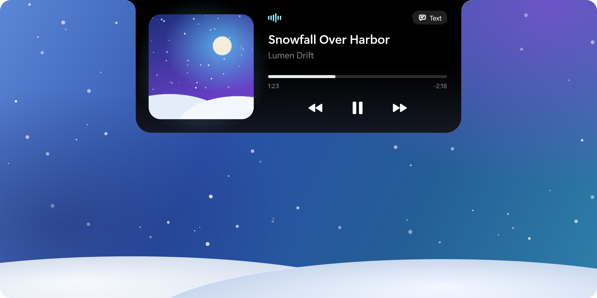
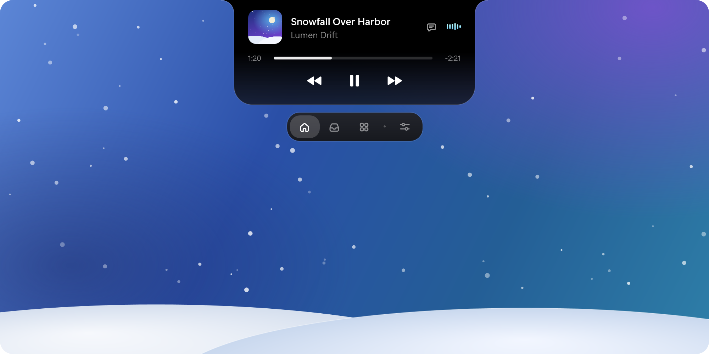
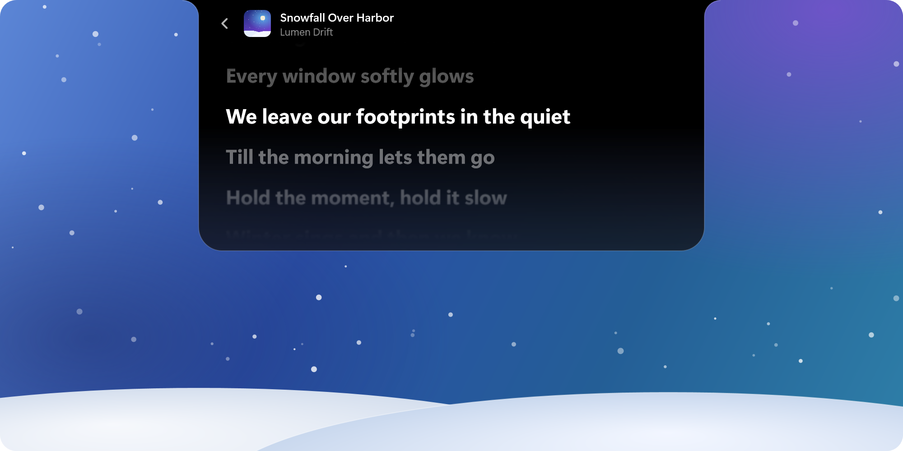
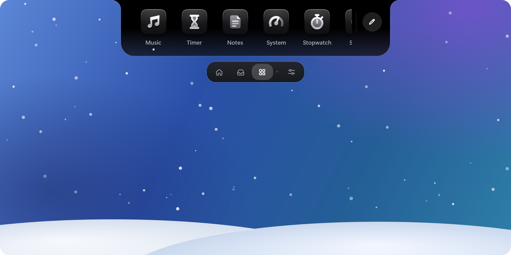
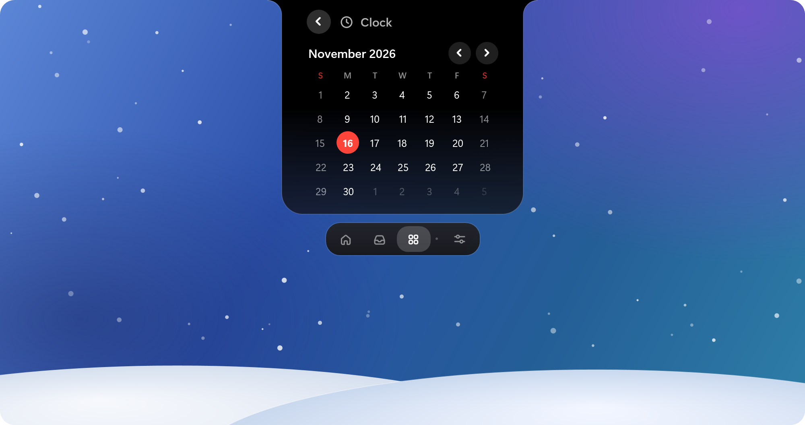
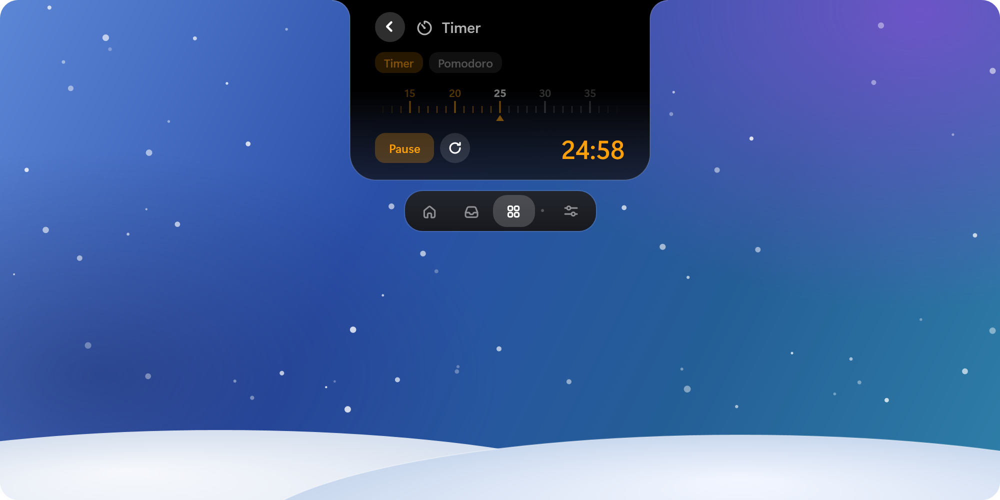
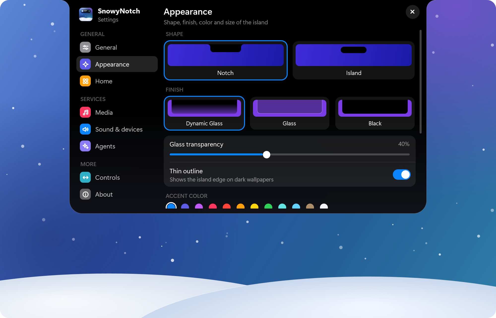

<p align="center">
  
</p>

<h1 align="center">SnowyNotch</h1>

<p align="center">
  A Dynamic Island–style notch for Windows.<br>
  Music, widgets, timers and a file tray, right at the top of your screen.
</p>

<p align="center">
  <a href="../../releases/latest"><b>⬇ Download for Windows</b></a>
</p>

<p align="center">
  
</p>

> [!TIP]
> **Island in the way of browser tabs or another app? Use the mouse wheel button (middle click) on it.**
>
> | Do this on the island | What happens |
> |---|---|
> | **Click** the wheel | The island turns see-through and clicks pass through it, so you can use whatever is underneath |
> | **Click** the wheel on the same spot again | The island comes back |
> | **Hold** the wheel for about half a second | The island hides completely |
> | **Hold** the wheel on the same spot (top center of the screen) again | The island comes back |
>
> Lost it? Right-click the SnowyNotch icon in the system tray and choose **Show island**.
> In full-screen games and videos the island hides by itself.

## Getting started

1. **Download** `SnowyNotch-x.y.z-win-x64.exe` from [Releases](../../releases/latest). It is a single file, nothing to install.
2. **Run it.** Windows may show *"Windows protected your PC"* because the app isn't code-signed yet. Click **More info → Run anyway**.
3. **Move the mouse to the top center of the screen.** The island opens. Move away and it closes.

Want it every time you turn on the PC? Put the exe in a permanent folder (for example `Documents\SnowyNotch`), then turn on **Settings → General → Launch with Windows**.

## Screenshots

<table>
  <tr>
    <td width="50%"><p align="center"><b>Now Playing</b> on hover</p></td>
    <td width="50%"><p align="center"><b>Lyrics</b> that follow the song</p></td>
  </tr>
  <tr>
    <td><p align="center"><b>Widgets</b> one click away</p></td>
    <td><p align="center"><b>Clock</b> with a month calendar</p></td>
  </tr>
  <tr>
    <td><p align="center"><b>File tray</b>: drop files, drag them back out</p></td>
    <td><p align="center"><b>Timer</b> and Pomodoro</p></td>
  </tr>
  <tr>
    <td colspan="2"><p align="center"><b>Settings</b>: shape, glass finish, accent color and more</p></td>
  </tr>
</table>

<sub>Screenshots use a made-up track, artwork and lyrics.</sub>

## Features

- **Now Playing**: artwork, progress, playback controls and synced lyrics for whatever music is playing in Windows (Spotify, browsers, other players).
- **Widgets**: sound (per-app volume), clock with month calendar, timer and Pomodoro, stopwatch, system monitor, Markdown notes, AI agent usage.
- **Your home row**: by default it shows music only. Add up to 3 widgets side by side via **Widgets → Edit Home**.
- **File tray**: drop files onto the island to keep them handy, then drag them out wherever you need them.
- **Looks**: notch or floating island, glass or solid black, 12 accent colors, adjustable size and speed.
- **18 languages**: English, 简体中文, 日本語, Deutsch, Français, Español, Italiano, Português, Nederlands, Polski, Čeština, Türkçe, Svenska, Norsk, Dansk, Suomi, Українська, Русский. Picked automatically from your Windows language, or choose in Settings → General.

## Controls

| Action | How |
|---|---|
| Open the island | Hover over the top center of the screen |
| Switch pages (Home, Files, Widgets) | Scroll over the island, or use the buttons under it |
| Make it see-through / hide it | Middle click / hold middle button on the island (see the tip above) |
| Open settings | `Win + /`, or left-click the tray icon |
| Per-app volume | `Win + Alt + V` |
| Quit | Right-click the tray icon → **Quit** |

## FAQ

**Is it safe? Why does Windows warn me?**
The exe isn't signed with a paid certificate, so SmartScreen doesn't know it yet. The full source code is in this repository, and `SHA256SUMS.txt` in each release lets you check the file wasn't changed.

**Which file should I download?**
`SnowyNotch-x.y.z-win-x64.exe` works on any Windows 10 (2004+) / 11 PC. The `-lite` version is smaller but needs the [.NET 8 Desktop Runtime](https://dotnet.microsoft.com/download/dotnet/8.0) installed.

**Does it use the internet?**
Only to look up song lyrics on [lrclib.net](https://lrclib.net) (can be turned off in Settings → Media). AI usage limits are fetched only if you turn that on yourself.

**Can I hide "Spotify" / "SoundCloud" next to the artist name?**
Yes: turn off **Settings → Media → Show where it's playing from**. Turn it back on the same way.

**Where are my settings and notes?**
In `%AppData%\SnowyNotch`. Paste that into the Explorer address bar to open it.

**How do I uninstall it?**
Turn off **Launch with Windows** if you enabled it, quit from the tray icon, then delete the exe. To remove settings and notes too, delete the `%AppData%\SnowyNotch` folder.

## Building from source

Needs the [.NET 8 SDK](https://dotnet.microsoft.com/download/dotnet/8.0).

```powershell
dotnet run                     # build and launch (Debug)
.\build-release.ps1            # release exe files -> ..\SnowyNotch-release\Release
dotnet run -- --shots=C:\shots # regenerate README screenshots (Debug only, demo data)
```

## License

[MIT](LICENSE)
